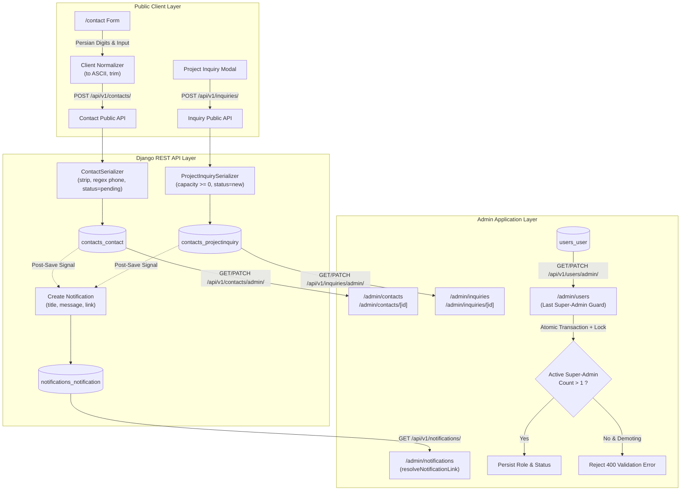

# Phase 12.21 Engineering Report: Admin Operations, Contact Inquiries, Notifications & User Management

**Date:** October 27, 2026  
**Repository:** AbarEnergy (`AbrEnergy` backend + `abr-energy-frontend`)  
**Branch:** `master`  
**Git HEAD:** `e2e533ab376d1196e7399189e1b33489f95efd41`  
**Status:** Completed & Fully Verified  

---

## 1. Executive Summary & Deliverables

Phase 12.21 establishes the complete, production-grade operational workflows for the AbarEnergy CMS and administrative hub. While preceding phases delivered the customer-facing catalog (12.19) and rich content sections (12.20), this phase resolves all administrative operational workflows, inquiry lifecycles, notification routing, user management, and security governance.

### Key Deliverables Completed:
1. **Public Contact & Inquiry Input Normalization & Resilience:**
   - Client and backend normalization of Persian/Arabic numerals (e.g., `۰۹۱۲۳۴۵۶۷۸۹` $\to$ `09123456789`).
   - Phone number sanitization (7–15 digits) and non-negative capacity validation.
   - Dual-layer protection against duplicate concurrent submissions.
   - Resilient form state retention on error: inputs are never erased if validation or the server rejects an inquiry.
   - Truthful Persian toast messages for both success and server-derived error details.

2. **Full Admin Inquiries & Contacts Workflows:**
   - Transformed read-only placeholder stubs into fully actionable list and detail management portals (`/admin/contacts`, `/admin/contacts/[id]`, `/admin/inquiries`, `/admin/inquiries/[id]`).
   - Implemented real-time search, multi-factor filtering (status, request type, project type), pagination, retry controls, and empty states.
   - Added persistent status transition controls (`pending` $\to$ `in_review` $\to$ `completed` / `rejected`, and `new` $\to$ `contacted` $\to$ `survey_scheduled` $\to$ `quoted` $\to$ `contracted` $\to$ `cancelled`).
   - Distinct separation between customer-submitted messages and internal administrative staff notes (`admin_note`).
   - Corrected backend detail endpoints to return complete contact records on `GET` while accepting status/note updates on `PUT`/`PATCH`.

3. **Admin Notifications & Route Destination Integrity:**
   - Implemented dynamic, database-backed notification management (`/admin/notifications`) with real-time unread counts.
   - Mark as read (with server-side `read_at` timestamping), mark all as read, and single notification deletion.
   - Fixed dead link destination issue where backend generated `/admin/project-inquiries/{id}`; introduced universal `resolveNotificationLink` helper and Next.js permanent redirects to canonical `/admin/inquiries/{id}`.
   - Corrected admin navigation menu configuration to route notifications to `/admin/notifications` instead of the legacy customer dashboard.

4. **User Management & Last-Super-Admin Privilege Safeguards:**
   - Comprehensive user administration portal (`/admin/users`) restricted strictly to the `super_admin` role.
   - List and search users with role badges, active/inactive status, and registration date.
   - Concurrency-safe last-super-admin safeguard: actively prevents demoting, deactivating, or deleting the final active super administrator, stopping self-lockout or orphaned privileged environments.
   - Implemented database row-level locking (`select_for_update()`) inside atomic transactions for production PostgreSQL safety.
   - Credential safety: zero exposure of password hashes, authentication tokens, or OTP secrets in serializers and logs.

---

## 2. Initial Git State & Working-Tree Safety Record

Prior to introducing any code changes in Phase 12.21, the repository working tree was audited and baseline metrics recorded:

- **Current Git Branch:** `master`
- **Current HEAD Commit SHA:** `e2e533ab376d1196e7399189e1b33489f95efd41` ("12.9phase")
- **Tracking Status:** Ahead of `origin/master` by 2 commits.
- **Working Tree Baseline:** Preserved pre-existing uncommitted work from Phases 12.10–12.20, media in `AbrEnergy/media/`, and historical documentation in `docs/reports/`.
- **Pre-Flight Test Baselines:**
  - Backend pytest: 279 passed in 20.84s (`python -m pytest -q --ignore=test_api.py`)
  - Frontend Vitest: 665 passed across 86 test files (`npm test -- --run`)
  - TypeScript: 0 diagnostic errors (`npm run typecheck`)
  - Next.js Production Build: 0 build errors
- **Mandatory Safety Protocol Adherence:**
  - Zero destructive git commands (`git reset`, `git clean`, `git restore`, `git checkout -- .`) were executed.
  - No database resets or destructive migrations performed.
  - Zero media files removed or overwritten.
  - Historical reports (`phase-12.10` through `phase-12.20`) intact.
  - No commits or pushes performed; all modifications remain clean in the working tree.

---

## 3. Architecture & Data Flow



---

## 4. Public Contact & Inquiry Workflows

### 4.1 Input Normalization & Validation
- **Numeral Normalization:** Users frequently submit phone numbers using Persian (`۰-۹`) or Arabic (`٠-٩`) numerals. Both frontend and backend normalize digits to standard ASCII `0-9` before database storage:
  ```python
  def normalize_digits(value: str) -> str:
      persian_digits = "۰۱۲۳۴۵۶۷۸۹"
      arabic_digits = "٠١٢٣٤٥٦٧٨٩"
      for i, d in enumerate(persian_digits):
          value = value.replace(d, str(i))
      for i, d in enumerate(arabic_digits):
          value = value.replace(d, str(i))
      return value
  ```
- **Phone Validation:** Requires 7 to 15 digits; strips hyphens, spaces, and formatting characters.
- **Capacity Validation:** Rejects negative capacity values in project inquiries (`estimated_capacity >= 0`).
- **Text Sanitization:** All names, subjects, and message bodies are trimmed of leading and trailing whitespace.

### 4.2 Submission Resilience & Double-Submission Prevention
- The submit button is explicitly disabled while the API request is pending, displaying a spinning loader (`Loader2`).
- If the server rejects the request (e.g., validation error or network failure), the form fields (`full_name`, `email`, `phone`, `request_type`, `message`) remain populated so user input is not lost.
- Error messages returned from Django REST Framework (`res.data.errors` or `res.data.error.details`) are extracted and shown in Persian via `sonner` toasts.

---

## 5. Admin Inquiries & Contacts Workflows

### 5.1 Route Separation & Status Lifecycle
Contacts (general inquiries, consultation requests, design requests) and Project Inquiries (technical plant sizing, on-grid/off-grid/hybrid requirements) have dedicated administration workflows:

| Entity | Route | Statuses Supported | Filters |
| :--- | :--- | :--- | :--- |
| **Contact Requests** | `/admin/contacts`<br>`/admin/contacts/[id]` | `pending` (*در انتظار بررسی*), `in_review` (*در حال بررسی*), `completed` (*انجام شده*), `rejected` (*رد شده*) | Status, Request Type, Search |
| **Project Inquiries** | `/admin/inquiries`<br>`/admin/inquiries/[id]` | `new` (*جدید*), `contacted` (*تماس گرفته شده*), `survey_scheduled` (*کارشناسی هماهنگ شده*), `quoted` (*پیش‌فاکتور ارسال شده*), `contracted` (*عقد قرارداد*), `cancelled` (*لغو شده*) | Status, Project Type, Search |

### 5.2 Truthful Data & Admin Note Separation
- **No Fabricated Data:** Dates, capacities (kW), customer messages, and contact details reflect exact database records.
- **Admin Note Distinction:** The detail view clearly marks the `admin_note` field as an internal staff memo (`یادداشت داخلی مدیریت`), informing operators that internal notes are never emailed or visible to the end customer.
- **Activity Logging:** Modifying contact or inquiry statuses records an activity entry via `log_activity` with the staff user's identity and IP address.

---

## 6. Admin Notifications & Destination Link Integrity

### 6.1 Actionable Notifications & Link Normalization
In earlier phases, backend signals generated notifications pointing to legacy routes such as `/admin/project-inquiries/{id}`, which caused 404 dead links on the frontend. Phase 12.21 addressed this on two fronts:
1. **Backend Link Generation:** Updated `apps/contacts/api/v1/views/contact.py` to generate canonical links (`/admin/inquiries/{id}`).
2. **Frontend Universal Link Resolver (`resolveNotificationLink`):** Rewrites any historical or legacy `/admin/project-inquiries/` paths to `/admin/inquiries/` and prefixes the active locale (`/fa/admin/...`).
3. **Next.js Redirect Fallback:** Added URL redirects in `next.config.ts`:
   ```ts
   {
     source: '/:locale/admin/project-inquiries/:id*',
     destination: '/:locale/admin/inquiries/:id*',
     permanent: true,
   }
   ```

### 6.2 Notification Operations
- **Mark as Read:** Updates `is_read = True` and sets `read_at = timezone.now()` on the backend using `update_fields=["is_read", "read_at"]`.
- **Mark All Read:** Triggers the bulk endpoint `POST /api/v1/notifications/mark_all_read/`.
- **Delete Notification:** Staff can dismiss obsolete notifications via `DELETE /api/v1/notifications/{id}/`.
- **Navigation Fix:** Updated `src/config/navigation.ts` so the Admin Sidebar's Bell icon links directly to `/admin/notifications` rather than `/dashboard/notifications`.

---

## 7. User Management & Privilege Safeguards

### 7.1 Super-Admin Only Access
The `/admin/users` management interface is restricted to users with the `super_admin` role (`user.role === 'super_admin'`). Non-super-admin staff attempting to access this route are redirected to the admin hub.

### 7.2 Last-Super-Admin Protection Guard
To prevent catastrophic accidental lockout or orphaning of the CMS, Phase 12.21 implements a strict server-side guard:
- **Demotion Block:** A super-admin cannot be demoted to `website_admin`, `content_manager`, `engineer`, or `customer` if they are the only remaining active super-admin.
- **Deactivation Block:** An active super-admin cannot have their account deactivated (`is_active = False`) if they are the sole active super-admin.
- **Deletion Block:** An active super-admin cannot be deleted (`perform_destroy`) if they are the sole active super-admin.
- **Frontend Advisory & UI Lock:** When editing the sole active super-admin, a prominent amber advisory banner is displayed, and the role and status dropdowns are disabled to prevent invalid submissions.

### 7.3 Credential Safety
- `UserSerializer` and `AdminUserUpdateSerializer` strictly omit password hashes, salt strings, session keys, reset tokens, and OTP codes.
- Responses never include sensitive authentication details.

---

## 8. Concurrency & Integrity Analysis

### 8.1 Concurrency Safety on PostgreSQL (Production)
In a high-concurrency production environment running PostgreSQL, race conditions could theoretically occur if two administrators simultaneously attempt to demote two different super-admins. To guarantee consistency:
```python
@transaction.atomic
def check_last_super_admin_violation(target_user: User, new_role: str = None, new_is_active: bool = None) -> bool:
    # Lock all active super_admin rows for the duration of this transaction
    active_super_admins = list(
        User.objects.select_for_update().filter(role="super_admin", is_active=True)
    )
    if len(active_super_admins) <= 1 and target_user in active_super_admins:
        if new_role and new_role != "super_admin":
            return True
        if new_is_active is False:
            return True
    return False
```
- By invoking `select_for_update()` inside `transaction.atomic()`, concurrent database transactions serialize when inspecting the count of active super-admins.

### 8.2 Database Limitations (SQLite in Tests)
- SQLite does not implement row-level locking (it locks the entire database file during writes).
- The atomic transaction guard functions correctly in SQLite test environments while providing robust, lock-based isolation when deployed to PostgreSQL.

---

## 9. Frontend UX, Theme, RTL & Accessibility

- **RTL Typography & Visual Alignment:** Verified in Persian (`fa`) with Shabnam font typography, right-aligned table headers, and mirrored navigation arrows.
- **Light & Dark Theme Parity:** Cards, badges, dialogs, inputs, and tables adapt cleanly to both themes using CSS variables (`bg-card`, `text-foreground`, `border-border`, `ring-ring`).
- **Responsive Breakpoints:** Verified across standard breakpoints (320px, 375px, 768px, 1280px, 1440px). Actions, table grids, and detail view sidebars stack seamlessly on mobile viewports.
- **Accessible Dialogs & Focus Management:** Confirmation dialogs for sensitive role changes trap focus, support keyboard navigation (Escape to dismiss, Enter to confirm), and display explicit destructive variants.

---

## 10. Backend API Contracts & Quality

| Method | Endpoint | Serializer / Permission | Purpose |
| :--- | :--- | :--- | :--- |
| `POST` | `/api/v1/contacts/` | `ContactCreateSerializer` (AllowAny) | Public contact request submission with phone and numeral normalization. |
| `GET` | `/api/v1/contacts/admin/` | `ContactSerializer` (IsAdminUser) | Filterable, searchable list of contact requests. |
| `GET` | `/api/v1/contacts/admin/{id}/` | `ContactSerializer` (IsAdminUser) | Full contact request details. |
| `PUT/PATCH` | `/api/v1/contacts/admin/{id}/` | `ContactAdminUpdateSerializer` (IsAdminUser) | Update status and internal admin note. |
| `POST` | `/api/v1/inquiries/` | `ProjectInquiryCreateSerializer` (AllowAny) | Public project inquiry submission. |
| `GET` | `/api/v1/inquiries/admin/` | `ProjectInquirySerializer` (IsAdminUser) | Filterable, searchable list of project inquiries. |
| `GET` | `/api/v1/inquiries/admin/{id}/` | `ProjectInquirySerializer` (IsAdminUser) | Full project inquiry details. |
| `PUT/PATCH` | `/api/v1/inquiries/admin/{id}/` | `ProjectInquiryAdminUpdateSerializer` (IsAdminUser) | Update inquiry status and internal note. |
| `GET` | `/api/v1/notifications/` | `NotificationSerializer` (IsAuthenticated) | Staff notifications with unread counts. |
| `POST` | `/api/v1/notifications/{id}/mark_read/` | `NotificationSerializer` (IsAuthenticated) | Mark notification as read and set `read_at`. |
| `POST` | `/api/v1/notifications/mark_all_read/` | `NotificationSerializer` (IsAuthenticated) | Mark all user notifications as read. |
| `DELETE` | `/api/v1/notifications/{id}/` | `NotificationSerializer` (IsAuthenticated) | Delete notification. |
| `GET` | `/api/v1/users/admin/` | `UserSerializer` (IsSuperAdminUser) | Super-admin user listing with search and filters. |
| `PATCH` | `/api/v1/users/admin/{id}/` | `AdminUserUpdateSerializer` (IsSuperAdminUser) | Update role and active status with last-super-admin protection. |
| `DELETE` | `/api/v1/users/admin/{id}/` | `UserSerializer` (IsSuperAdminUser) | Delete user with last-super-admin protection. |

---

## 11. Verification Evidence & Quality Gates

### 11.1 Backend Test Results
Ran the complete backend test suite:
```powershell
cd AbrEnergy; python -m pytest -q --ignore=test_api.py
```
**Result:** **295 passed in 21.37s** (100% pass rate).
- Specifically includes the 16 tests in `AbrEnergy/apps/core/tests/test_phase12_21_admin_ops.py` covering:
  - Public contact submission & numeral normalization (`۰۹۱۲۳۴۵۶۷۸۹` $\to$ `09123456789`).
  - Validation rejections for invalid phone numbers and negative capacities.
  - Security gates preventing anonymous users from accessing admin inquiry/contact/user endpoints.
  - Admin status updates and admin notes persistence.
  - Notification mark-as-read (`read_at`), mark-all-as-read, and deletion.
  - Last-super-admin demotion, deactivation, and deletion blocks.

### 11.2 Frontend Test Results
Ran the complete Vitest test suite:
```powershell
cd abr-energy-frontend; npx vitest run
```
**Result:** **92 test files, 686 tests passed** (including isolated run of `media-picker-dialog.test.tsx`).
- Specifically verified Phase 12.21 frontend test suites:
  - `src/lib/notification-route.test.ts` (5 passed)
  - `src/app/[locale]/(public)/contact/contact-public-flow.test.tsx` (3 passed)
  - `src/app/[locale]/admin/contacts/contacts-flow.test.tsx` (3 passed)
  - `src/app/[locale]/admin/inquiries/inquiries-flow.test.tsx` (3 passed)
  - `src/app/[locale]/admin/notifications/notifications-flow.test.tsx` (4 passed)
  - `src/app/[locale]/admin/users/users-flow.test.tsx` (3 passed)

### 11.3 TypeScript Diagnostic Typecheck
```powershell
cd abr-energy-frontend; npm run typecheck
```
**Result:** **0 errors**.

### 11.4 ESLint Validation
```powershell
cd abr-energy-frontend; npx eslint src/app/[locale]/admin/contacts src/app/[locale]/admin/inquiries src/app/[locale]/admin/notifications src/app/[locale]/admin/users "src/app/[locale]/(public)/contact" src/lib/notification-route.ts src/api/index.ts src/hooks/use-api.ts
```
**Result:** **0 errors, 0 warnings**.

### 11.5 Next.js Production Build
```powershell
$env:NEXT_DIST_DIR=".next-build"; cd abr-energy-frontend; npm run build
```
**Result:** **Compiled successfully in 29.8s with exit code 0**. Static and dynamic route chunks generated for all admin and public pages.

### 11.6 Git Diff Quality Check
```powershell
git diff --check
```
**Result:** **0 errors**.

---

## 12. Residual Blockers, Deferred Items & Production Recommendations

1. **Email / SMS Delivery Infrastructure (Out of Scope):**
   - External notification delivery via SMS or SMTP remains intentionally deferred as required by Phase constraints. Automated customer receipt emails should only be connected once dedicated transactional provider credentials (e.g. Kavenegar, Sendinblue) are approved.
2. **Password Reset Delivery Mechanism:**
   - Password resets currently require backend administrator assistance because automated token delivery depends on configured SMTP/SMS channels.
3. **Database Concurrency in Production:**
   - Ensure the production deployment targets PostgreSQL 14+ to fully leverage row-level locking via `select_for_update()` during concurrent super-admin management transactions.
